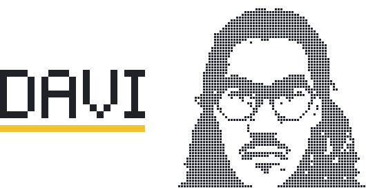
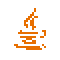
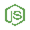
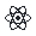
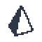
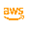
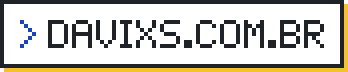

<p><picture><source media="(prefers-color-scheme: dark)" srcset="./imgs/art/header-dark.svg"></picture></p>

```text
 .-----------------------------------------------------------------------------.
 | (x) (-) (+)                     ~/about.txt                                 |
 |-----------------------------------------------------------------------------|
 |                                                                             |
 | PT  Desenvolvedor Full-Stack na Grid360 (04/2026 - atual). Construo APIs,   |
 |     serviços back-end e aplicações web completas, do banco de dados à       |
 |     interface, com foco em código limpo, performance e boa experiência.     |
 |                                                                             |
 |     > Back-end:  Node.js, NestJS, Fastify, Java/Spring Boot e Python        |
 |     > Front-end: React, Next.js, TypeScript e Tailwind CSS                  |
 |     > Dados:     PostgreSQL, SQLite e Prisma ORM                            |
 |     > Infra:     Docker e AWS                                               |
 |                                                                             |
 |     Cursando Análise e Desenvolvimento de Sistemas na Fatec Franca          |
 |     "Dr. Thomaz Novelino" (4º de 6 semestres).                              |
 |                                                                             |
 | EN  Full-Stack Developer at Grid360 (04/2026 - present). I build APIs,      |
 |     back-end services and full web applications, from the database to       |
 |     the UI, focused on clean code, performance and great experiences.       |
 |     Studying Systems Analysis and Development at Fatec Franca.              |
 | -@daviixs                                                                   |
 |                                                                             |
 '-----------------------------------------------------------------------------'
```

<p><picture><source media="(prefers-color-scheme: dark)" srcset="./imgs/headings/stack-dark.svg"></picture></p>

<p>
  <picture><source media="(prefers-color-scheme: dark)" srcset="./imgs/icons/lang-javascript-dark.svg"></picture
  ><picture><source media="(prefers-color-scheme: dark)" srcset="./imgs/icons/lang-typescript-dark.svg"></picture
  ><picture><source media="(prefers-color-scheme: dark)" srcset="./imgs/icons/lang-python-dark.svg"></picture
  ><picture><source media="(prefers-color-scheme: dark)" srcset="./imgs/icons/lang-java-dark.svg"></picture>
</p>

<p>
  <picture><source media="(prefers-color-scheme: dark)" srcset="./imgs/icons/lang-nodejs-dark.svg"></picture
  ><picture><source media="(prefers-color-scheme: dark)" srcset="./imgs/icons/lang-nestjs-dark.svg"></picture
  ><picture><source media="(prefers-color-scheme: dark)" srcset="./imgs/icons/lang-fastify-dark.svg"></picture
  ><picture><source media="(prefers-color-scheme: dark)" srcset="./imgs/icons/lang-springboot-dark.svg"></picture>
</p>

<p>
  <picture><source media="(prefers-color-scheme: dark)" srcset="./imgs/icons/lang-react-dark.svg"></picture
  ><picture><source media="(prefers-color-scheme: dark)" srcset="./imgs/icons/lang-nextjs-dark.svg"></picture
  ><picture><source media="(prefers-color-scheme: dark)" srcset="./imgs/icons/lang-tailwind-dark.svg"></picture>
</p>

<p>
  <picture><source media="(prefers-color-scheme: dark)" srcset="./imgs/icons/lang-postgresql-dark.svg"></picture
  ><picture><source media="(prefers-color-scheme: dark)" srcset="./imgs/icons/lang-sqlite-dark.svg"></picture
  ><picture><source media="(prefers-color-scheme: dark)" srcset="./imgs/icons/lang-prisma-dark.svg"></picture
  ><picture><source media="(prefers-color-scheme: dark)" srcset="./imgs/icons/lang-docker-dark.svg"></picture
  ><picture><source media="(prefers-color-scheme: dark)" srcset="./imgs/icons/lang-aws-dark.svg"></picture>
</p>

<p><picture><source media="(prefers-color-scheme: dark)" srcset="./imgs/headings/social-dark.svg"></picture></p>

<p>
  <a href="https://linkedin.com/in/davi-xavier-silva/"><picture><source media="(prefers-color-scheme: dark)" srcset="./imgs/icons/linkedin-dark.svg"></picture></a
  ><a href="https://github.com/daviixs"><picture><source media="(prefers-color-scheme: dark)" srcset="./imgs/icons/github-dark.svg"></picture></a
  ><a href="mailto:xaviersilvadavi@gmail.com"><picture><source media="(prefers-color-scheme: dark)" srcset="./imgs/icons/email-dark.svg"></picture></a>
</p>

<p><picture><source media="(prefers-color-scheme: dark)" srcset="./imgs/headings/portfolio-dark.svg"></picture></p>

<p><a href="https://davixs.com.br"><picture><source media="(prefers-color-scheme: dark)" srcset="./imgs/art/portfolio-dark.svg"></picture></a></p>

```text
 davi@github ~ % exit
 logout
 Saving session...completed.

 [Process completed]▌
```
